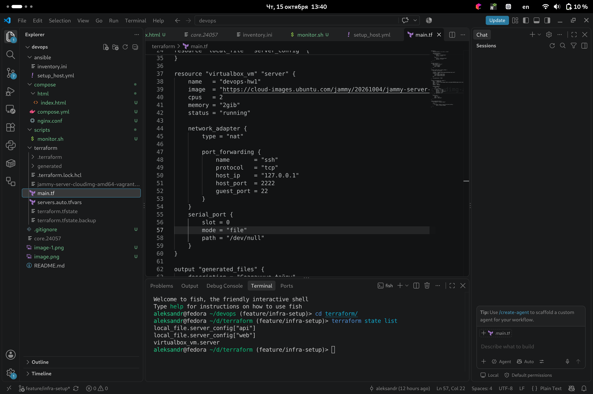
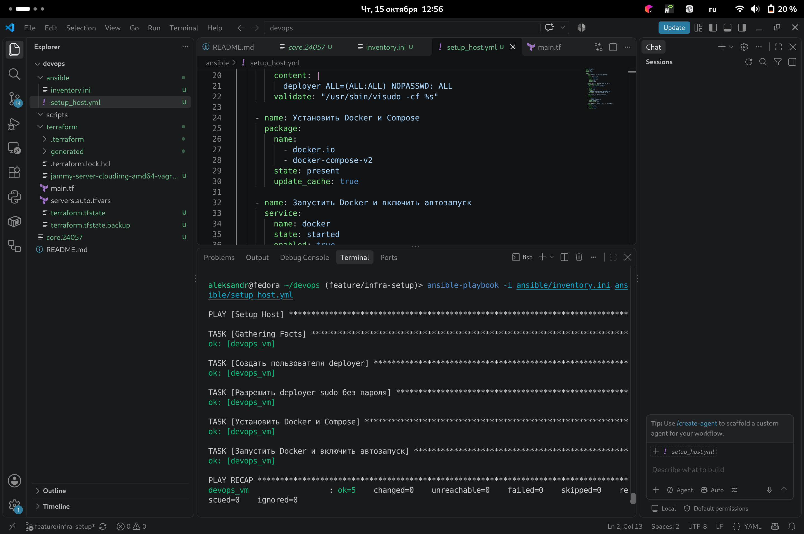
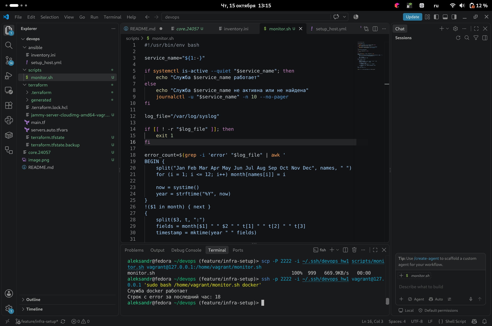
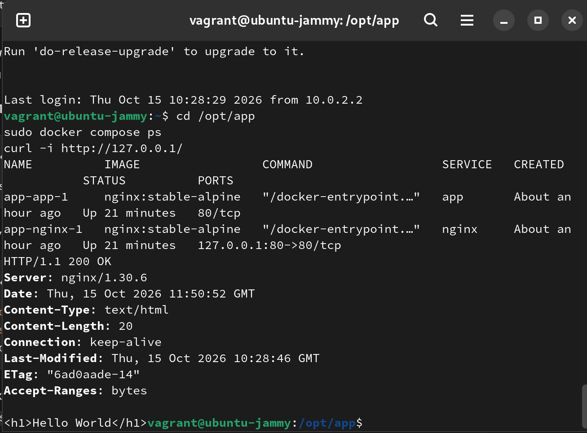

## Архитектурные решения

- **VirtualBox и Ubuntu 22.04.** Выбран локальный запуск.
- **NAT и SSH-туннель.** NAT обеспечивает Ubuntu выход в интернет.
  SSH-проброс привязан к `127.0.0.1:2222` Fedora. Приложение открывается через
  SSH-туннель на порту 8081.
- **Два контейнера Nginx.** Сервис `nginx` принимает запросы и пересылает их
  сервису `app`, который отдаёт Hello World. Контейнеры соединены сетью
  `app_net`
- **Готовые образы и файлы только для чтения.** HTML и конфигурация Nginx
  подключаются через bind mounts с `ro`, поэтому их можно обновлять без сборки собственного образа. `restart: unless-stopped` обеспечивает перезапуск контейнеров после запуска Docker, если они не были остановлены вручную.

# Скриншоты:

## Terraform

## Ansible:

## Script

## Compose 

